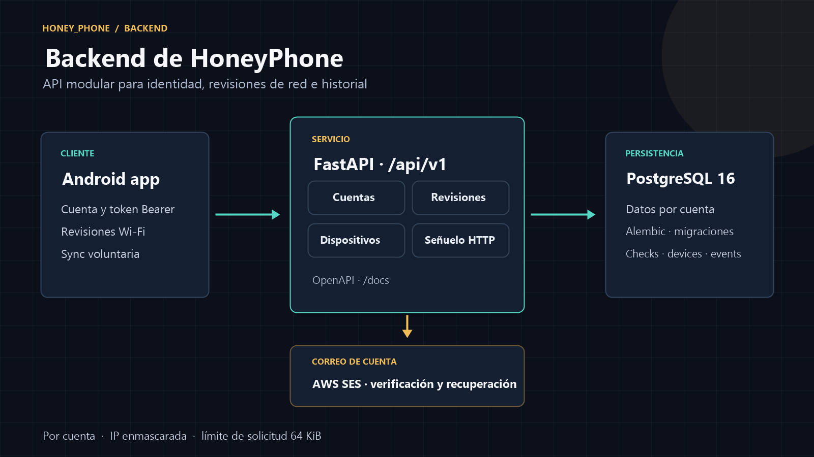

# HoneyPhone Backend

<p align="center">
  
</p>

<p align="center"><strong>API para cuentas, revisiones de red y eventos del señuelo.</strong><br />FastAPI · PostgreSQL · OpenAPI</p>



HoneyPhone Backend es el servicio de la app Android. Administra cuentas, autentica solicitudes, asocia instalaciones y conserva revisiones y eventos con aislamiento por usuario. La versión de la API se define en `src/honeyphone/main.py`.

## Funcionalidades

- Registro con correo, verificación por correo, inicio de sesión con contraseña y recuperación de acceso mediante enlaces de un solo uso.
- Inicio de sesión con Google ID token, validado contra `GOOGLE_CLIENT_IDS`.
- Lectura, consulta paginada y eliminación de revisiones de red; la creación es idempotente por `check_id`.
- Registro, consulta, renombrado y revocación de instalaciones Android.
- Sesiones y lotes de eventos del señuelo HTTP. Las IP que llegan a la API deben estar enmascaradas como `/24` en IPv4 o `/64` en IPv6; no se aceptan cuerpos de petición.
- OpenAPI en `/openapi.json`, Swagger UI en `/docs` y páginas para acciones de cuenta.

La API no determina por sí sola que una red sea segura o esté comprometida. Cuando la app no tiene destinos controlados para DNS o HTTPS, esos indicadores se mantienen como `NOT_CONFIGURED`.

## Tecnologías y requisitos

- Python 3.12 o posterior
- FastAPI, Pydantic Settings, SQLAlchemy 2, psycopg 3 y Alembic
- Docker Compose para PostgreSQL 16 en desarrollo local

## Desarrollo local

Desde la raíz de este repositorio, crea el archivo local de entorno sin reemplazar uno que ya exista:

```bash
# macOS / Linux
if [ ! -f .env ]; then cp .env.example .env; fi
python3 -m venv .venv
source .venv/bin/activate
```

En Windows PowerShell:

```powershell
if (!(Test-Path .env)) { Copy-Item .env.example .env }
py -3.12 -m venv .venv
.\.venv\Scripts\Activate.ps1
```

Instala la API y sus dependencias de desarrollo, inicia PostgreSQL y aplica las migraciones:

```bash
python -m pip install -e ".[test]"
docker compose --env-file .env -f infra/compose.yaml up -d db
python -m alembic -c alembic.ini upgrade head
```

Inicia el servidor:

```bash
python -m uvicorn honeyphone.main:app --app-dir src --reload --host 127.0.0.1 --port 8000
```

La API queda disponible en `http://127.0.0.1:8000`; consulta `/healthz`, `/docs` y `/openapi.json`. PostgreSQL se publica solo en loopback, en el puerto `5433` por defecto.

## Configuración

`.env.example` documenta las variables. Los valores de ejemplo son únicamente para desarrollo local.

| Variable | Uso |
| --- | --- |
| `DATABASE_URL` | Conexión SQLAlchemy a PostgreSQL. |
| `AUTH_SECRET_KEY` | Firma de sesiones Bearer; en producción debe ser aleatoria y tener al menos 32 caracteres. |
| `GOOGLE_CLIENT_IDS` | IDs de cliente OAuth autorizados, separados por comas. Necesario para Google Sign-In. |
| `AWS_REGION` | Región usada por SES para correo de verificación y recuperación. |
| `EMAIL_FROM` | Remitente verificado para SES. |
| `PUBLIC_BASE_URL` | Origen público que usan los enlaces de cuenta. |
| `APK_DOWNLOAD_URL` | Destino opcional de la ruta `/download`. |
| `POSTGRES_DB`, `POSTGRES_USER`, `POSTGRES_PASSWORD`, `POSTGRES_PORT` | Configuración del servicio PostgreSQL de Compose. |

En producción, suministra las credenciales de AWS mediante un rol o el proveedor de credenciales de AWS; no las agregues a `.env.example` ni al repositorio. No despliegues con el secreto local de ejemplo.

## Rutas principales

| Área | Rutas |
| --- | --- |
| Salud | `GET /healthz` |
| Cuenta | `POST /api/v1/auth/register`, `/login`, `/google`, `/verify-email/request`, `/verify-email/confirm`, `/password/forgot`, `/password/reset`; `GET` y `DELETE /api/v1/auth/me` |
| Revisiones | `POST` y `GET /api/v1/network-checks`; `GET` y `DELETE /api/v1/network-checks/{check_id}` |
| Dispositivos | `POST` y `GET /api/v1/devices`; `GET`, `PATCH` y `DELETE /api/v1/devices/{installation_id}` |
| Señuelo | `POST` y `GET /api/v1/honeypot/sessions`; `POST` y `GET /api/v1/honeypot/sessions/{session_id}/events` |

`/healthz` y las operaciones públicas de autenticación no requieren sesión. Las consultas de cuenta y todas las rutas de datos requieren `Authorization: Bearer <token>`. Las consultas de revisiones aceptan filtros y cursor; el límite por página es 50. El tamaño máximo de una solicitud es 64 KiB.

## Migraciones y contrato

Alembic es la fuente ejecutable del esquema. Después de cambiar rutas o modelos, actualiza el contrato desde la raíz del repositorio:

```bash
python scripts/sync-openapi.py
```

Consulta [`contracts/README.md`](contracts/README.md), [`contracts/openapi.yaml`](contracts/openapi.yaml) y los ejemplos sintéticos en `contracts/examples/`. Las rutas marcadas como P1/diseño no están implementadas como funciones operativas.

## Pruebas de integración

Las pruebas usan una API en ejecución y una base PostgreSQL desechable cuyo nombre debe comenzar con `honeyphone_verify_`. Define `HP_TEST_BASE_URL` y `DATABASE_URL` para esa misma instancia, aplica las migraciones y ejecuta:

```bash
python -m pytest -q
```

Las pruebas se niegan a ejecutar escrituras sobre una base que no cumpla el prefijo requerido. [`scripts/README.md`](scripts/README.md) describe las herramientas auxiliares.

## Estructura

```text
src/honeyphone/
├── core/                 # configuración, base de datos, middleware y errores
├── modules/
│   ├── accounts/         # autenticación y acciones de cuenta
│   ├── checks/           # revisiones de red y persistencia
│   ├── devices/          # instalaciones asociadas a cuentas
│   ├── health/           # estado del servicio
│   ├── honeypot/         # sesiones y eventos
│   └── site/             # páginas públicas de cuenta/descarga
└── static/               # páginas servidas por la API
```

## Licencia

El código propio de este repositorio se distribuye bajo MIT; consulta [`LICENSE`](LICENSE). Las dependencias y otros componentes de terceros mantienen sus licencias respectivas.
